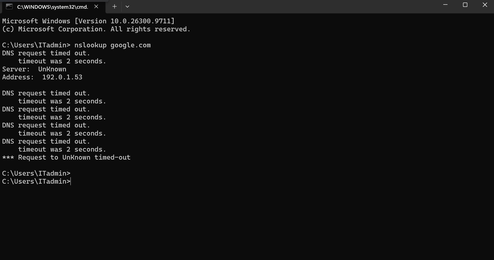
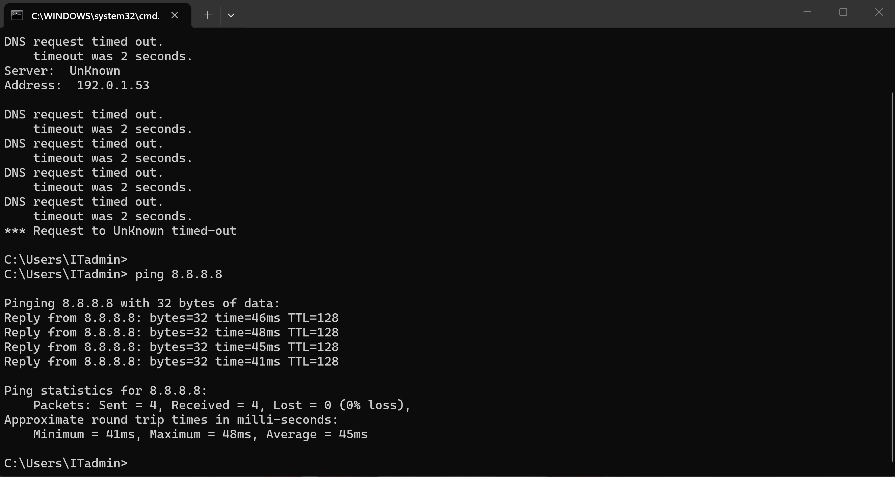
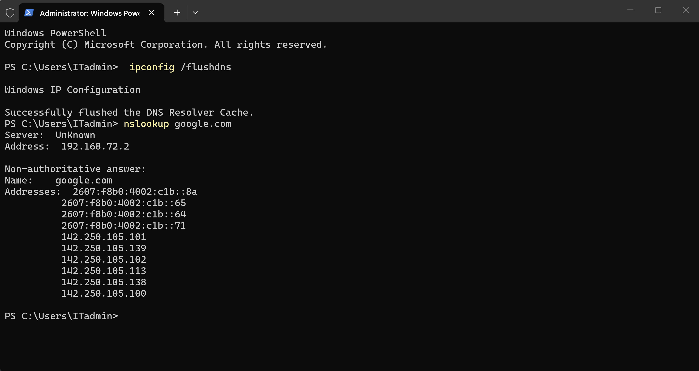
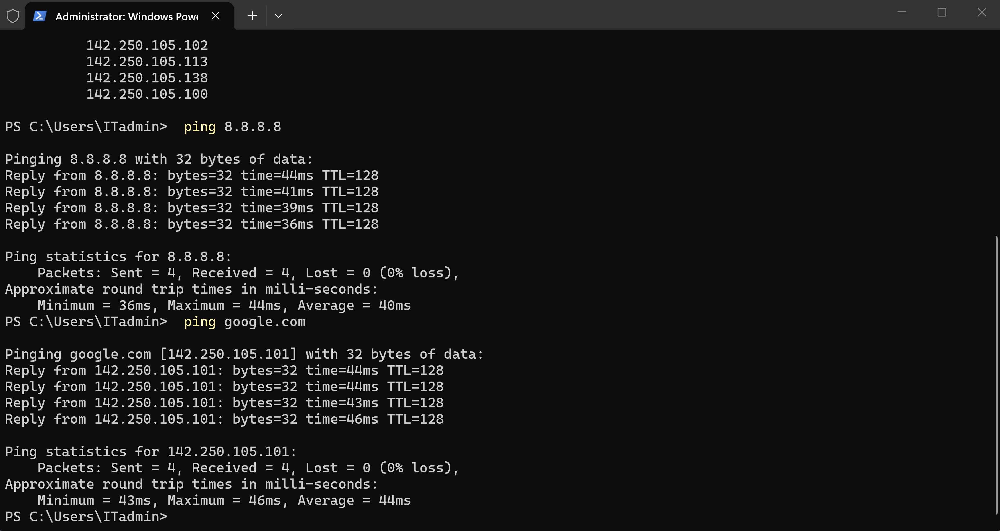

# TechNova-DNS-Troubleshooting
Windows 11 DNS troubleshooting lab - TechNova IT Support Ticket #1041
# TechNova IT Support — Ticket #1041

## Windows 11 DNS & Network Troubleshooting

**Status:** Resolved  
**Category:** Network Connectivity / DNS  
**Environment:** Windows 11 Pro, VMware Workstation  
**Lab Type:** Simulated IT Support Incident

## 1. Incident Description

A simulated employee workstation (PC01) was experiencing DNS resolution failures, preventing reliable access to websites and online resources.

The objective was to identify the root cause, restore DNS functionality, and verify network connectivity using standard IT troubleshooting tools.

## 2. Lab Environment

| Component | Configuration |
|---|---|
| Client workstation | PC01 — Windows 11 Pro |
| Virtualization | VMware Workstation |
| Network adapter | NAT |
| Incorrect DNS server | 192.0.1.53 |
| Correct DNS server | 192.168.72.2 |
| Troubleshooting tools | PowerShell, Command Prompt |

## 3. Troubleshooting Procedure

### Step 1 — Verify IP Connectivity

Executed:

`ping 8.8.8.8`

**Result:** Successful replies with 0% packet loss.

This confirmed basic IP connectivity.

### Step 2 — Diagnose DNS Resolution

Executed:

`nslookup google.com`

**Result:** DNS request timed out.

The workstation could reach an external IP address but could not resolve domain names.

### Step 3 — Identify the Root Cause

Inspected the workstation's DNS configuration.

The DNS server was incorrectly configured as `192.0.1.53`, which was not responding to DNS requests.

### Step 4 — Correct the DNS Configuration

Changed the DNS server to `192.168.72.2`, the working DNS address in the VMware NAT environment.

### Step 5 — Flush the DNS Cache

Opened PowerShell as Administrator and executed:

`ipconfig /flushdns`

The command completed successfully.

### Step 6 — Verify the Resolution

Executed:

- `nslookup google.com`
- `ping google.com`
- `ping 8.8.8.8`

**Result:** DNS resolution was restored and connectivity tests succeeded.

## 4. Root Cause Analysis

The incident was caused by an incorrect DNS server configuration on PC01.

IP connectivity remained functional, but DNS requests were timing out because the configured DNS server was not responding.

## 5. Resolution

Updated the DNS server configuration, flushed the DNS resolver cache, and verified successful domain name resolution and connectivity.

**Final Ticket Status: Resolved**

## 6. Screenshots & Evidence

The following screenshots document the simulated incident and troubleshooting process.

### Evidence 1 — DNS Resolution Failure

### Evidence 2 — IP Connectivity Test

### Evidence 3 — DNS Resolution Restored

### Evidence 4 — Final Connectivity Verification

## 7. Technical Skills Demonstrated

- Windows 11 network troubleshooting
- DNS configuration and name resolution
- TCP/IP connectivity testing
- PowerShell and Command Prompt
- `ping`, `nslookup`, and `ipconfig`
- Root cause analysis
- Incident documentation
- Post-resolution verification

## 8. Key Takeaway

Successful IP connectivity does not necessarily mean DNS is functioning correctly. Testing IP connectivity and DNS resolution separately helps isolate the cause of network access problems.

---

**TechNova — Hands-on IT Support Portfolio**  
**Ticket #1041 | Windows 11 DNS Troubleshooting**
